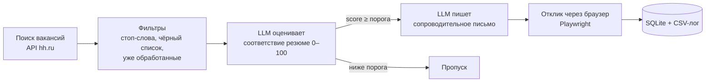

# HH Job Agent — AI-агент для поиска работы на hh.ru

Python-агент, который автоматизирует поиск работы: находит свежие вакансии на hh.ru, с помощью LLM (Claude) оценивает, насколько каждая подходит под резюме, пишет персональное сопроводительное письмо и откликается через браузер.

Проект сделан как практика по автоматизации многошагового процесса с помощью LLM — от сбора данных до действия.

## Как это работает



1. **Сбор данных.** Поиск вакансий через публичный API hh.ru (если API недоступен — парсинг выдачи сайта) по запросам, региону, опыту и периоду из `config.yaml`.
2. **Фильтрация.** Отсекаются вакансии со стоп-словами в названии (senior, lead, руководитель…), компании из чёрного списка и вакансии, которые уже обрабатывались.
3. **Оценка LLM.** Для каждой вакансии модель получает резюме и описание вакансии и возвращает JSON: оценку соответствия 0–100, причину и текст письма. В промпте прямо запрещено выдумывать опыт и цифры, которых нет в резюме.
4. **Отклик.** Если оценка выше порога `min_score`, агент открывает вакансию в браузере, выбирает нужное резюме, прикладывает письмо и откликается.
5. **Учёт.** Все результаты сохраняются в SQLite (`vacancies.db`) и `log.csv`: оценка, причина, письмо, статус. Повторно на одну вакансию агент не откликается.

## Стек

- **Python 3.10+**
- **LLM:** Claude через Anthropic SDK или любой OpenAI-совместимый API (OpenRouter, Ollama, DeepSeek)
- **Playwright** — работа с сайтом как в обычном браузере
- **requests** — API hh.ru
- **SQLite, CSV** — хранение и логирование
- **YAML** — конфигурация без правки кода

## Безопасный режим и ограничения

- **Пробный режим (`dry_run: true`)** по умолчанию: агент только оценивает вакансии и пишет письма, ничего не отправляя. Результат можно проверить в `log.csv`.
- **Дневной лимит** откликов и случайные паузы между ними (по умолчанию до 30 в день, 40–120 с).
- **Капчу агент не обходит**: останавливается и просит человека решить её в окне браузера.
- Вакансии с анкетой или тестом от работодателя пропускаются — на них лучше откликаться вручную.
- Автоматические отклики не предусмотрены правилами hh.ru, поэтому агент рассчитан на аккуратное личное использование с высоким порогом соответствия, а не на массовую рассылку.

## Установка

```bash
git clone https://github.com/<ваш-логин>/hh-job-agent.git
cd hh-job-agent
python -m venv .venv
.venv\Scripts\activate          # Windows;  Mac/Linux: source .venv/bin/activate
pip install -r requirements.txt
playwright install chromium
```

Ключ LLM задаётся переменной окружения (в коде и конфиге ключей нет):

```bash
set LLM_API_KEY=ваш_ключ        # Windows;  Mac/Linux: export LLM_API_KEY=ваш_ключ
```

Без платного API можно использовать локальную модель через [Ollama](https://ollama.com): в `config.yaml` указать `base_url: http://localhost:11434/v1` и, например, `model: qwen2.5:14b`.

## Запуск

1. Скопируйте `resume.example.txt` в `resume.txt` и вставьте туда полный текст своего резюме.
2. Проверьте `config.yaml`: поисковые запросы, регион, `resume_title`, `min_score`.
3. `python agent.py login` — откроется браузер, войдите в hh.ru вручную (сессия сохранится локально).
4. `python agent.py run` — пробный прогон. Посмотрите оценки и письма в `log.csv`.
5. Когда результат устраивает — `dry_run: false` и снова `python agent.py run`.
6. `python agent.py stats` — сводка по статусам.

## Структура

```
agent.py              — вся логика: поиск, оценка LLM, отклик, учёт
config.yaml           — настройки поиска, LLM, лимитов и браузера
resume.example.txt    — шаблон резюме (рабочий resume.txt не хранится в репозитории)
requirements.txt      — зависимости
```

## Если что-то сломалось

hh.ru периодически меняет вёрстку. Если отклики перестали проходить, обновите селекторы в словаре `SEL` в `agent.py` (атрибуты `data-qa` видны через «Просмотреть код» в браузере).

---

Автор: Матвей Петров
